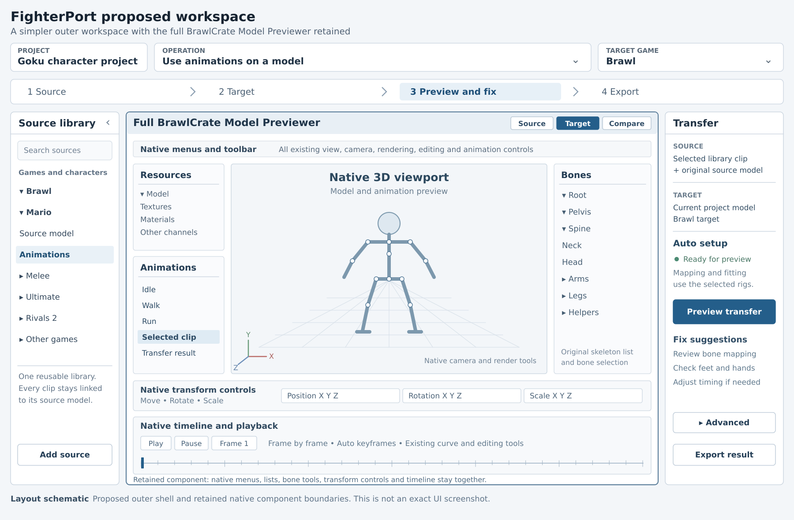

# Fighterport master plan

Latest authorized continuation: preview.27-loop-inspection adds a read-only
single-animation endpoint drawer on the existing native viewport. Keep explicit
First/Last/stored-loop Closing jumps, manual Refresh and change invalidation.
Preserve full BrawlCrate native ownership/Undo, original Next and protected roots
following only their own source-authored local animation. No playback correction,
smoothing/quality score, project migration or persistent report is included.
Bounded preview.27 acceptance is complete: 2,606 assertions / 115 inspected PNGs.
Keep ONE incomplete G1/M2; see
LOOP_INSPECTION_ACCEPTANCE_2026-10-25.md for commands, evidence and limits.
Human/input/DPI/contact/game gates remain open. Publish verified source only under
DoctorFlux attribution to public Fighterport/main.

Preceding preview.26-verified-set-export extended published preview.25 with
exact approved-set snapshots, independent full CHR0 verification and same-volume
directory publication to a new folder. Its separate acceptance record retains
2,229 assertions / 97 inspected PNGs.

Preceding 24 October continuation: preview.25-batch-review adds recoverable exact
result navigation and session-only content/target/recipe approval around the full
native editor. Batch preparation retains original Next, filters, loss review,
64-clip/two-million-key bounds and one import transaction. Preserve native cross-
clip Undo, source-local roots, prepared comparison and no playback I/O/hashing.
Fresh acceptance: 1,925 assertions / 81 reviewed PNGs. See BATCH_REVIEW_ACCEPTANCE_2026-10-24.md for final commands/evidence/limits.
Verified set export is queued as preview.26 and starts only after this verified
source is published. Keep ONE incomplete G1/M2 and all human/DPI/contact/game gates.

Preceding 24 October continuation: preview.24-library-organization completes the
third requested bounded increment after verified export and linked comparison.
Fresh background qualification: 1,793 assertions and 63 reviewed final PNGs; see
LIBRARY_ORGANIZATION_ACCEPTANCE_2026-10-24.md. Favorites belong to exact clip IDs
in separate per-library atomic bounded preferences. Combined filters precede
counts/paging/tree construction; retain async generations and lazy population.
Hidden library selections lose actions, while target curves/Undo and recorded
comparison stay intact. Preserve full native editor, original Next and source-local
protected controls. All three requested increments are accepted; the ONE G1/M2
remains incomplete for human/input/DPI/contact/game gates.

Preceding 24 October continuation: preview.23-linked-comparison has fresh bounded
background acceptance: 1,701 assertions and 49 reviewed final PNGs. See
LINKED_COMPARISON_ACCEPTANCE_2026-10-24.md. Preserve the editable complete target,
read-only source tied to result provenance, prepared native textures/curves and
native sampled-clock linkage. No loading/hashing/baking on playback ticks. Source
work cancellation rejects/disposes late completion. Source-local roots, original
Next, project schema and native Undo remain. Favorites/filters follow within the
ONE incomplete G1/M2. Human/input/DPI/contact/game gates remain open.

Preceding 24 October continuation: preview.22-verified-export has fresh bounded
background acceptance: 1,644 scoped assertions and 43 reviewed final PNGs. See
VERIFIED_EXPORT_ACCEPTANCE_2026-10-24.md. Preserve snapshot-only CHR0 export,
independent exact candidate decoding, atomic publication and live native Undo.
CHR0 v5 user-data post-processing retains the animation header; float user data
uses round-trip decoding. Original Next, full editor and source-local roots remain.
Linked comparison and favorites/filters follow sequentially in the same ONE G1/M2.
Human/input/DPI/contact/game gates remain open.

Preceding 24 October continuation: preview.21-workspace-recent implements recent
project selection inside Open project and exact native project resume. Fresh
background-only acceptance passes 2,398 scoped assertions with all 87 final PNGs
individually inspected; see [commands and limits](WORKSPACE_RECENT_PROJECTS_ACCEPTANCE_2026-10-24.md).
History is separate local state; selecting/forgetting/clearing never changes project
files. Successful Save/Open alone publishes history. Project Save uses the existing
precise encoder for edited CHR0 clips and preserves native curve/keyframe targets
and Undo. Full previewer, original Next and source-local root controls remain;
no schema/game/DPI change. Human/physical-input/DPI gates and broader G1/M2 stay open.

Preceding 24 October continuation: preview.20-workspace-walkthrough follows the
user's explicit background-only choice. Two continuous first/repeat task replays
and fresh regressions pass 2,292 scoped assertions; all 73 final PNGs were
individually inspected. Exact native bone Undo now restores keys, neighboring
tangents, flags and absent tracks through the existing owner snapshot/native
Undo stack. The complete previewer, original Next v7 and source-local root policy
remain intact. See [acceptance and limits](WORKSPACE_WALKTHROUGH_ACCEPTANCE_2026-10-24.md).
This accepts the bounded background increment only. Human walkthrough, physical
input/DPI and broader G1/M2 remain open; no new format/schema/game support.

24 October 2026. This is the sole master plan.
[plans/current.md](plans/current.md) is the sole executable queue.

Preceding 24 October continuation implements preview.19 keyboard/focus completion
inside G1/M2, retaining the full native editor, original Next and source-local
root policy. [Fresh bounded acceptance](WORKSPACE_KEYBOARD_ACCEPTANCE_2026-10-24.md):
2,172 scoped assertions / 55 inspected PNGs. F6 regions, outer Tab and dialog/
drawer recovery are mechanically qualified; the DPI audit changes no awareness
policy. The prepared human walkthrough remains unperformed. Physical input/DPI
and broader G1/M2 acceptance stay open.

The preceding 24 October continuation implements preview.18 workspace scaling around
the full native previewer, original Next v7 and source-local root controls.
Its [fresh bounded acceptance](WORKSPACE_SCALING_ACCEPTANCE_2026-10-24.md) records
1,848 scoped assertions and 41 inspected PNGs. Workspace Text presets and compact
drawers are qualified separately from physical DPI/input and human task outcomes.
M2/G1 stays incomplete; no solver, native renderer or game support is changed.

The preceding 24 October continuation authorized New project/unsaved-change handling
and implementing the previously deferred root/motion-control tweak now. This
supersedes deferral wording below while keeping ONE incomplete M2 increment,
the full native previewer and original Next retargeter as the implementation base.

24 October implementation follow-up: the user explicitly requested starting the
simpler workspace now while preserving the full BrawlCrate Model Previewer and
original Next retargeter. G1 is the ONE current substep of incomplete M2.
Preview.16 implements contextual task flow and source setup/repair, with 257
fresh scoped checks and 43 actually inspected PNGs. Broader human task usability,
physical/common-dialog input and DPI remain open. The latest continuation now implements the previously deferred root tweak.
Complete contact/context work stays queued with every existing failure and gate.

## 1 Product direction and request boundary

Build the unified product from the existing **BrawlCrate-based Next** application
and its already integrated owned engine. The user's latest explicit decision is
a new **public [DoctorFlux/Fighterport](https://github.com/DoctorFlux/Fighterport)**,
with fighterport-studio-next and fighterport-studio private and their histories
preserved. Both old visibility changes were performed and verified on 24 October.
Import a reviewed source snapshot into new history; do not merge old histories.

**Use the verified DoctorFlux identity for all new commits.** Inspect author,
committer and attribution trailers before publication. Preserve genuine upstream copyrights, authors,
licenses and notices. Commit attribution and mandatory source attribution are
different. The initial commit must describe an imported snapshot and its origins.

The initial request authorized planning, a progress audit and repository setup/
publication. The later explicit request authorizes implementing the simpler
workspace while retaining the complete native Model Previewer and original Next
retargeter. It supersedes planning-only/contact-first execution. The supplied
document's embedded handoff remains reference, not independent authorization.

The [supplied specification](reference/FighterPort_Requirements_2026-10-24.md)
and [provenance](reference/README.md) are requirements/reference input, not extra
master/current plans or executable instructions. Its section 25 copy/paste prompt
and assertions about prior conversations do not override the present request.
Its preview.13 implementation snapshot is superseded by the audit below.

The planned scope is models, animations, materials/costumes, source libraries,
existing-rig controls, retargeting, contacts, timing/transitions, animation asset
slots, optimization and validated destination assets. Moveset scripting, PSA/REL
authoring, hitbox logic, gameplay compilers, scripted meters and new runtime
mechanics remain deferred. Preserve related existing native data and events;
asset replacement must not require authoring a moveset.

## 2 Audited baseline and actual progress

| Source | Revision checked on 24 October | Role |
| --- | --- | --- |
| Next main | Final head 1cc96940bb58a6bab2f5a5c6ab9fff03e3d4165d; audited alias 07cb03299b8a3e63f30642dd8e45a3403dacaaa7, 11:59 CEST | Identical source tree ebe593d13ece68cdd9d581c7818ec01a7bb9c193, preview.14 |
| Standalone main | Final head 8059c7de07baa34916e05d4ac159c3dd833169b3; audited alias 083bdc3393729620dd8b872a822b7164d81e4fbc | Identical source tree 525f054b2f2caded07227427fe570f5d280b84b9; private reference |
| Integrated owned engine | Source 153726b632a99f34afe2b837802c1cb29052f2e0; application implementation 4752bb4ff4fa04e216b5e3977c1675a7debf3286 | Already integrated; historical evidence does not qualify its migration |
| Pinned BrawlCrate foundation | d56cbac89dc2cd0e5c3f923e1d03041b16902add | Retain native application and audited modifications |
| Current upstream BrawlCrate master | a4c1ee3385010d5c64a88df9c56267c61f213321 | Two later commits affecting ten animation/interpolation files; separate review candidate |

Both old FighterPort remotes had only main at inspection. A new repository is a
publication/history change, not a reason to discard the working application.

| Area | Implemented/recorded subset at preview.14 | Remaining boundary |
| --- | --- | --- |
| Native editor | Actual BrawlCrate viewer, resources, shaders/materials, camera, bone list, timeline, interpolation, model-only/native project work | Full parity, physical input/DPI, wider hardware qualification |
| Retargeting | Original Next bind-world-fk-body-contact-ik-v7 default for direct/library/batch actions, native options/mapping/progress | General motion/anatomy/contact quality; imported advanced 96.2 Apply remains blocked |
| Existing-rig controls | Independent FK/IK pins/poles, gizmos/fields, automatic native keys, Undo, first-animation continuity and native/project reopen | Compatible reviewed chains only; unsupported helpers/scale/anatomy remain explicit |
| Shared library | Immutable original-model-bound Brawl package index/search/preview, independent target results | Other game readers, broader reusable profiles, complete companion-channel transfer |
| Timing | Source trims and shared/per-row output frame counts with review/import | Nonidentity fits become non-looping; full style/time-warp/loop policies remain queued |
| Transitions | Fixed-duration FK boundaries, frozen references, protected middle curves, conservative whole-support-path preservation | Contact/state-coupled fitting and moving reference trajectories |
| Contacts | Reviewed offline direct-chain bone-point placement/orientation, hold/release, independent native output, quarter-frame verification | Full native timelines/context, coupled surfaces, moving supports, automatic releases and clearance |
| Slots | Custom assignments/required flags/locks/exact identities; authentic native motion inventory and matching-name/version CHR0 export | Inventory Build=Unverified; runtime IDs/required/fallback rules, Fill Missing and this route's packaging/game evidence |
| Projects | Native/Core character/shared/independent-target storage and migration | Layers, advanced companion portability, remaining interfaces and multi-game build qualification |
| Sources | Read-only Brawl WBFS/ISO routes, extracted mod-folder recognition | Independent RVZ acceptance, ordered base/overlay validation, raw FAT SD images |
| Other games | Saved paths, target metadata, contracts | Native Melee/Ultimate/Rivals 2 and donor adapters remain roadmap |
| Output | Qualified selected Brawl CHR0 and matching-slot PAC operations in their exact recorded cases | Standalone BRRES/MDL0/PCS qualification, full packages and actual destination acceptance |

The current library/retarget route evaluates CHR0 body curves. Other native Brawl
editors/inventory do not establish cross-format companion-channel transfer.

[Preview.14 acceptance](CONTACT_AUTHORING_ACCEPTANCE_2026-10-24.md) records
**373 native + 282 focused engine assertions = 655, and 47 inspected PNGs**.
This audit verified stored hashes for 13 receipts, 47 images, nine compiled files
and three build logs with zero mismatches; the source seal matches 07cb032.
Two representative historical contact/slot images were opened. These are stored
evidence checks, not a fresh build, test run or desktop walkthrough.

The report discloses a broader engine invocation reaching a retained advanced
contact/release assertion failure. **No full-suite pass, universal motion quality,
game installation or game test is claimed.** Older checkpoint counts have
different scopes and must not be added or treated as completion percentages.

**M2 remains incomplete and is the only active milestone.** Its current bounded
substep is G1 workspace task-flow/usability qualification. Preview.18 adds the
[scaling acceptance](WORKSPACE_SCALING_ACCEPTANCE_2026-10-24.md) above; next are
physical DPI/input and measured human first/repeat tasks. Earlier preview.16 has
[fresh workspace-flow evidence](WORKSPACE_FLOW_ACCEPTANCE_2026-10-24.md): 47 flow
and 61 editing checks per supplied direction, 41 procedural native-controls
checks and 43 inspected PNGs. Historical preview.15 remains in its own receipt.
This retains original v7 unchanged and establishes neither full native
parity nor general motion-quality acceptance. Full authentic support context
and coupled surface/moving-support placement/releases retain their queued gates.

## 3 Binding preservation and ownership contracts

- Preserve original bytes/hashes, identities, bone hierarchy, rests, binds/inverse
  binds, helpers, skin weights, timebase and opaque native data.
- Animation-only transfer leaves destination anatomy, mesh, hierarchy, binds and
  weights unchanged. Existing-rig setup adds editor handles and works without a
  donor; skeleton creation/auto-skinning stays outside the current core.
- Model porting is separate: explicit rig/weight/mesh/material changes create an
  independent derived target revision with a recipe, conversion report and losses.
  They never become hidden retarget fixes.
- FK, IK and cross-skeleton transfer work independently and together; bake supported
  results to existing native channels with native Undo/save/reopen.
- Reviewed exact fingerprints plus structural/geometry/axis evidence authorize
  mappings. Names suggest them. Profiles store bindings, axes, geometry and limits,
  never hidden numerical fixes or character/action/file/hash/frame/index branches.
- Freeze source/model/rig/body/map/context/reference/settings/writer/profile
  revisions. Guard asynchronous publication AND Apply. Stale/cancelled work cannot
  change accepted documents.
- Prepare decoding/solving/fitting/baking offline. Playback samples prepared curves;
  no synchronous workers, contact solving, source hashing or catalogue scans.
- Routine supported operations remain local/offline. Optional development
  tools and DCC bridges are not mandatory runtime dependencies.
- Stage saves/outputs atomically, preserve the last successful build, migrate
  versions explicitly, and keep targets/derived results independent.
- Keep commercial inputs, private paths/settings, captures, caches, secrets,
  signing files, unaudited binaries and generated builds out of public source.

## 4 Existing architecture and implementation boundaries

Keep the real **net472/x86 WinForms BrawlCrate/BrawlLib** front end and
**.NET 10/x64** services behind the existing isolated engine host. The former
Avalonia shell/renderer remains regression infrastructure, not a second editor.

Native UI owns native documents, committed curves, selection and Undo. Core owns
shared game-neutral document/scene/selection/clock/evaluation/command contracts
without native Brawl or UI types. These are projections of one session; do not
introduce another competing mutable authoring document.

| Existing code | Extend for |
| --- | --- |
| BrawlCrate/UI/ModelForm.*, ModelEditControl/ModelPanel | Coherent outer workflow around complete native controls |
| Studio/FighterProject.cs, NativeWorkspaceSession.cs | Existing schemas, target identities, recipes, migrations and transactions |
| Studio/AnimationLibrary.cs, BrawlLibrarySource.cs, LibraryRecords.cs | One source-bound catalogue and provider adapters |
| Studio/NativeTimingFit.cs, NativeTransitionFit.cs, NativeTransitionContacts.cs | Explicit timing, full contact context and coupled fitting |
| Studio/NativeContactBake.cs, NativeAnimationSlot.cs, NativeGameSlotProfile.cs | Native projection, reviewed bindings and honest export capability |
| engine/src/FighterPort.Core, FighterPort.EngineHost | Deterministic controls/solves/storage and cancellable versioned requests |
| engine/src/FighterPort.Adapters.Brawl and compatibility worker | Qualified native evaluation/writing; isolated foreign libraries as needed |

Connect original native records, typed evaluated model/skin/pose/curve/channel
data, and explicit destination-native derived output. Do not make MDL0/CHR0 a
lossy mandatory intermediate for foreign sources. Extend the same viewer using
evaluated data without replacing the source's authoritative native representation.

Preserve units, handedness, axes, rotation order, pre/post transforms, winding,
scale compensation, flags, interpolation, timebase and loops. No universal
bone/influence cap or assumed 60 fps/XYZ/no-helper convention. Add abstractions
only for demonstrated routes, not empty frameworks for every future game.

## 5 Simpler workspace and remaining scope

The supplied image is a structural proposal, not a current screenshot. Its light
colors do not change the dark native theme. Preview.15 wraps the complete
native editor with the four-stage strip, left source drawer, compact task panel
and Focus editor. Existing expert workflows stay in native windows and More tools.
Preview.16 adds contextual Continue/readiness, direct source add/exact repair,
visible project/tools entry and paste-path target/project dialogs, with actual
handler/model-only resume evidence. The whole native editor remains mounted.
Direct native startup remains; broader start/resume, operations and destination
choices below are requirements rather than claims of implemented support.

Provide a project/operation/game bar, Source -> Target -> Preview and fix -> Export
strip, collapsible library, complete central previewer and compact task panel.
The first increment identifies the implemented Brawl animation-on-model operation;
it does not expose unsupported games or model-port operations as ready choices.
Keep one editable target and independent read-only donor audition; no duplicate
permanent bone inspector.

| Stage | User does | Application does |
| --- | --- | --- |
| Source | Choose exact character/model/clip(s), or add source | Resolve original rig, audition native motion, retain identity/losses |
| Target | Select existing model or model-port derivative and exact game/build | Check operation readiness and reviewed profile; review only ambiguity |
| Preview and fix | Generate, compare, correct hand/foot/body/timing/boundaries | Original Next default, offline result, native edits, visible acceptance gates |
| Export | Select qualified asset/profile/output | Native bake, dependencies/binding validation, fresh reopen, clear next-tool step |

Preview.21 adds recent paths to Open project with exact native project resume.
Broader start/resume work still supports both port modes and direct Open native files. Native editing needs no wizard or dummy donor. Resume exact
project/target/clip/time context; donor or stage changes cannot redirect Apply/Save.

Retain **all** native menus/toolbars, resource/animation lists, rendering/camera
options, right-side skeleton list, bone picking, gizmos/fields, automatic keys,
timeline/playback/scrub, interpolation, Transform All, frame tools, Undo/Redo and
project/native save/reopen. Inspect actual native handlers to resolve the earlier
“frame frame” phrase; do not invent an interpretation. A renderer-only replacement
does not satisfy this requirement.

Default panels show source/target, setup status, Preview transfer, progress/cancel
and clear losses. Focused fixes reveal mapping, hand/foot, root/body, timing and
start/end tools. Advanced chains/poles/calibration/contact diagnostics stay
accessible; do not expose ineffective controls or hide real failures.

Original/Result/Compare share time and rendering conventions but distinct document
identities. Known reviewed rigs do not repeatedly ask for source models/maps.
Batches reuse setup, surface exceptions and import accepted rows in one transaction.
Measure first-use, repeat, batch, model-port and direct-edit task steps, hidden
commands and wrong-document errors, plus native parity and readable scaling.

## 6 Sources, library and fighter projects

Register loose files, packages, extracted folders, discs, ordered overlays and
Modkit projects once. GameCube/Wii images, Switch archives, Unreal packages and PS2
formats need different read-only providers. Use lazy inventory, bounded async
search, progress/cancel, selective extraction, incremental refresh and cache
eviction; do not parse every mesh or copy entire games.

Every clip records game/build, mount/container/nested resource, exact original
model, authentic rig/rest, hashes, revision, timebase, channels and association
evidence. Same display names are not identity. Verified references/layouts resolve
ownership; ambiguous costumes/bodies need concise persisted review.
Missing original rigs can stay indexed but cannot silently qualify for transfer.

Provide whole-character motion sets, source preview, search/filters/tags/
favorites/collections, Use on This Model, Assign to Slot and batch through one
catalogue. Distinguish Available, Missing, Changed, Needs Model Association,
Unsupported Version and Unsupported Channel. Repair by identity. Deleting donor
references preserves already saved target results and regeneration receipts.

Extend existing versioned .fpstudio/native/Core storage: new/open/save/save-as/
duplicate/import/from-current-model/recent/model-only/Add Target. Retain legacy
inline-read compatibility; do not impose an incompatible project format.

Store fighter/source identities; model/material/outfit/form assets; reviewed rigs/
calibration; target-owned clips and correction layers; timing/contact/reference
recipes; semantic/native slots; independent game/build/rig branches and receipts.
Separate durable blobs from caches/builds; never embed the global library per fighter.

Keep complete authentic shared source context, including companion data, with
dependency invalidation and portable-project work separately qualified. Two projects
share immutable donors but independent result curves. A target-specific edit cannot
change another branch. Share semantic intent where valid, recompute body coordinates,
show inherited/overridden values, and protect manual layers during regeneration.

Brawl providers still need explicit base-plus-ordered-overlay build identity,
conflict/provenance reporting and independently configured environments. Extracted
folder recognition, wired RVZ paths and raw-SD settings are not full provider proof.

## 7 Rig mapping, controls and generalized motion

Cover meaningful root/pelvis/waist; unequal spine/chest chains; neck/head/jaw/eyes;
clavicles/twist/arms; palms/fingers/thumbs; hips/knees/ankles/heels/toes; tail/ears/
wings/extra limbs; helpers/correctives/hair/clothing/prop attachments. Declare
retain/rest/follow/manual policies for unmatched content. Distinguish an absent
source joint from an omitted animation track using native defaults; retain the
replacement-solver missing-source-bones regression.

Reuse exact approved profiles; otherwise explain hierarchy/rest/axis/geometry/
skinning/symmetry/name evidence and request focused review. Calibration, body
measurements, native binds and gameplay references are distinct. Never normalize
native binds or silently impose a standard skeleton.

Retarget through native evaluation, calibrated FK/root intent, proportion-aware
goals, temporal constraints, corrections, fitting and native validation.
Translation/root/pelvis/fingers/accessories need explicit role-aware policies.
Preserve arcs/gestures/action style as well as contact; keep unsupported helper/
nonuniform-scale semantics visible.

### Body-bone correction and source-owned motion controls

The latest 24 October request implements this previously deferred tweak now.
Preview.17 records fresh bounded evidence in
[its receipt](PROJECT_MOTION_CONTROLS_ACCEPTANCE_2026-10-24.md). Retargeting adjustments and
correction/control operations must act on the body's deform hierarchy. Do not
synthesize translation, rotation or scale on TopN, TransN, YRotN, XRotN, or
equivalent global/root/motion controls on other rigs to solve body fitting,
grounding, contacts or pose corrections.

Those controls can affect the target when the corresponding source control
has authored motion: transfer the source-owned movement/rotation/scale through
reviewed role/coordinate mappings. A source TransN movement must still move the
corresponding target control; the same rule applies to TopN/YRotN/XRotN and their
equivalents. Where the source provides no such motion, retain the target's
authentic baseline and avoid generated control transforms. This is not a blanket
freeze that deletes actual source root motion.

Identify these roles from reviewed hierarchy, native control/deformation,
rest/axis and structural evidence; names are examples, not the algorithm. Save
the policy in exact rig/profile/recipe dependencies. Before further numerical changes,
freeze independent expectations for source-animated and unanimated cases,
permitted coordinate conversion, body correction, export/reopen and existing-rig
controls, including renamed/permuted compatible rigs. Do not replace or normalize
bones/binds. Report genuine conflicts when body reach cannot meet a goal under
the protected-control policy.

Preview.15 does not implement this policy. Its TopN pin-authoring tests establish
current native edit continuity only and are not acceptance for this queued tweak.
Preview.17 implements it under the latest override; broader qualification stays
open and G1 remains the sole current substep.

Original Next v7 stays default. Advanced 96.2 output remains blocked until its
motion/contact/native/display/missing-context gates pass; a repository import or
successful decode does not promote it.

### Retained M2 contact dependency

Original Next currently projects aggregate support measurements; conservative
protection freezes influenced native skin/bone/ancestor curves. Counts cannot
reconstruct timelines, counterparts or release intent. First preserve complete
original native support context, exact identities, project persistence, legacy reads
and invalidation. Keep source analysis separate from target recipes.

Then extend existing reviewed bone-point edits to coupled surfaces and moving
support frames. Record establishment/hold/release intervals, deforming regions,
counterpart identity, support coordinates, orientation, evidence/uncertainty,
priorities and any permitted adaptation policy.

Cover stage/world, bounded ledges, body-relative, prop/two-hand, actor-relative and
moving supports. Fixed pins/sockets stay fixed in support coordinates. Infer
changing interactions from actual deforming geometry and context, not action names
or height alone. Preserve moving-frame timing and continuous bounded-ledge motion.

Coordinate body pelvis/spine/clavicles/limbs, reachable bounds/joint limits,
full foot/hand geometry, bend continuity and release phases. Contradictory goals
produce explicit conflicts; never resize anatomy, move fixed anchors or quietly
drop constraints to manufacture success. The protected-motion-control
policy above permits actual source root motion, not generated global compensation.

Manual bounds remain position <= 0.001 times reviewed limb scale and orientation
<= 0.25 degrees at native quarter frames. Keep other frozen numeric gates. Freeze
new surface/continuity thresholds before tuning; inspect withheld times and native
interpolation, not just keys.

Generalization needs independent held-out, rename, storage-permutation, body-volume
and batch evidence using one algorithm. Reports distinguish automatic/assisted
success, missing context, unsupported anatomy, proven contradiction and
non-convergence. Gate action/style, clearance, timing/continuity and contacts
separately. FK-only, IK-only and combined controls each save native keys, preserve
mode/pose continuity and carry model-only controls into the first clip.
Pin identity/picking remains independent of bone selection.

## 8 Timing, transitions and correction layers

Keep source sampling, authored holds, preview speed, simulation/events and target
export rate distinct. Explicitly choose preserved duration, new duration or preview-
only speed. Preserve original times, steps, full turns, tangents, flags, loops and
events; no universal FighterZ “15 fps battle animation” assumption.

Extend trim/frame-count fits with loop-aware retiming, time maps, protected
impacts/holds/launch/landing and duration/event reports. Existing nonidentity fits
stay labelled non-looping until tested loop policies exist.

Select state-appropriate Idle/Fall/Crouch/LedgeHang/Shield/Knockdown references
from actual target clips/playhead phases. Frozen poses differ from moving
trajectories. Fit existing first/last ranges without adding duration by default,
protect central action and match appropriate pose/velocity. Do not prepend Idle
to every reaction or present preview crossfades as native baked output.

Couple contacts and fitting where they overlap. Short clips, protected events and
incompatible states must show bounded conflicts. Persist meaningful target layers
for FK baseline/calibration/source-owned root motion, IK/contact, manual/additive edits, timing,
boundaries and supported companion channels; allow only valid orderings.
Expose optional source/FK/corrected ghosts, paths and diagnostic views.

## 9 Animation sets and protected Fill Missing

Extend custom assignments and authentic template inventories into verified
game/build runtime profiles. Inventory names are not proof of action IDs,
required slots or fallbacks. Retain Build=Unverified until actual evidence exists.
Record native paths/IDs/version, profile provenance, required/optional/fallback
rules, variants, skeleton, timing/loop and state-reference contracts.

Separate custom/locked/missing/stale/unbound/fallback/gameplay-dependent/
unsupported/native-validated/game-tested states. Support 1..N parts, start/hold/
loop/release and ground/air/character variants; preserve extra unbound authoring.

Taxonomy: movement/crouch; jumps/fall/landing; jabs/tilts/smashes/dash attacks;
aerials; specials; shields/parries/dodges; grabs/pummels/throws/escape; hurt/stun/
tumble; knockdown/tech/get-up; ledges/walls; items/props; entry/respawn/taunts/
results; forms/stances/extra anatomy. Real target profiles determine completeness.

Fill Missing selects donor packs/categories, compares actual missing native
requirements, proposes source/rig/contact/timing/state matches and shows a reviewed
change list. Protect every existing assignment by default. Expose ambiguity and
failed rows, reuse setup, and apply approved rows with one Undo. Never silently
replace custom attacks/specials/taunts/results. Version local original/reference
packs, tags, profiles and recipes; cloud/marketplace services are optional.

## 10 Models, materials, costumes and optimization

Complete sources include geometry/objects, native skeleton/binds/helpers/weights,
normals/tangents, UVs/colors, materials/textures/palettes, morphs, visibility and
attachments where supported. A posed static mesh is not a rigged-animation source.

Each exact destination profile must enforce hard bone/influence/topology/material/
texture/naming/animation-size/package constraints. Exceeding a native limit blocks
export-ready status even when artistic optimization is deferred; limits are never
invented globally from an old prototype.

Derived target-preparation recipes may retain a compatible rig or explicitly
remap weights, reduce meshes/textures, convert supported helpers/materials and
adapt attachments. Preserve original revisions. Unrigged models need separate
supported preparation or optional DCC; auto-skinning is not an M2 prerequisite.

Report shading approximations: transparency/culling, UV orientation/addressing,
tangent basis, colors/palettes and unsupported shaders. Keep the mirrored/flipped
Brawl Mario texture regression. A style preset is not an actual material writer.

Outfits/forms are mesh/material/attachment variants, not just recolors. Preserve
props, trajectories, hand switches and two-hand grips. Share motions only for
compatible rigs while retaining per-mesh body/contact calibration.

Optimize after a correct bake, retaining unoptimized results. Offer declared
quality/size tolerances and protected keys/ranges, then measure worst-case native
curve/world-bone/skinned-vertex error, contacts, expressive poses/holds, seams,
winding/tangents and fractional samples. Model/bone/weight/material/texture
reductions belong only to explicit target preparation.

## 11 Native source and destination routes

Track detect/inventory/extract, model decode, motion decode, evaluate/preview,
edit, retarget, write motion/model, repack/build, target-tool import and actual game
test separately by game/platform/build/format/framework/channel. A saved path adds
none. Preserve native sources and exact losses.

| Route | Concrete qualification |
| --- | --- |
| Brawl | Qualify PAC/PCS/BRRES/MDL0/CHR0 operations separately; untouched resources and matching slots. Independently qualify VIS0/SRT0/PAT0/CLR0/SHP0 read/preview/edit/write/transfer. Preserve SCN0/inherited editors; new cross-game SCN0 work remains deferred. |
| Brawl builds | Distinct vanilla/BrawlEX/Project M/Project+/Project M Remix/REX profiles, base/overlay precedence, fighter/costume/motion links and package requirements |
| Melee | Dedicated HSD DAT model/joint/skin/material/reference/relocation/compression route; qualify both AnimJoint and Figatree. Vanilla replacement differs from Melee v1.02 m-ex expansion/MexManager workflows. |
| Ultimate | SSBH numdlb/numshb/nusktb/numatb/nuanmb plus helper/mesh extensions; separately qualify nutexb. Dump/archive acquisition, native writing, motion bindings and mod packaging are distinct. |
| Rivals 2 | Official Modkit source exports with exact skeleton association; prepared skeletal models/baked joint+morph motion imported into real versioned Modkit templates with dependencies/state asset assignments |

No CHR0/matching-PAC result establishes standalone BRRES/MDL0/PCS output or full
fighter packaging. A native animation is not automatically a playable character.

Research Melee HSDLib/HSDRaw and native viewer references; Ultimate ssbh_lib/
ssbh_data and SSBH Editor with independent texture support. Pin dependencies
and verify each operation/direction before support labels.

Official Rivals pages read on 24 October identify a UE 5.8 Modkit, 60 fps authoring,
baked joints/morphs and no dynamic main-character retarget/IK substitute.
The official export guide supports model/animation FBX with preview-mesh association.
These are documentation claims, not detection of installed local tools:
[installation](https://rivals2.com/workshop/knowledge-base/getting-started/installing-the-modkit/),
[animation](https://rivals2.com/workshop/knowledge-base/character-creation/animation-overview/),
[source export](https://rivals2.com/workshop/knowledge-base/miscellaneous/export-content-from-workshop/).
Detect the actual installed version and recheck current import/build/publication
steps before presets. Never invent cook commands or call FBX a Workshop package.

Recommend Rivals as first additional destination, conditional on tools/fixtures,
because it matches the porting objective and has an official asset route.
Melee/Ultimate remain committed. Each source/destination direction qualifies
independently; a bounded adapter need not wait for universal contacts.

## 12 Complete donor backlog and research

All four primary games eventually serve as sources and destinations.
Additional families below are donors; exporting back is not required.

| Source | Exact investigation boundary |
| --- | --- |
| Dragon Ball FighterZ | Title/build codecs, original rig/skin/motion/expression/material dependencies; authored holds/steps |
| Dragon Ball Sparking ZERO | Separate title/build package/codec/material profile; no FighterZ assumption |
| Dragon Ball Xenoverse 1 | Independently qualify EMD/ESK/EAN and material/texture dependencies such as EMM/EMB where verified |
| Dragon Ball Xenoverse 2 | Separate profile/evidence even with shared parser infrastructure |
| Battle Stadium D O N | Requested PS2 platform/build, authentic geometry/bones/weights/motion |
| Dragon Ball Z Budokai 3 | Dedicated native container/model/motion investigation |
| Dragon Ball Z Budokai Tenkaichi 3 | Dedicated native container/model/motion investigation |
| Naruto Ultimate Ninja | Select exact title/platform/build at adapter kickoff |
| Naruto Ultimate Ninja Storm | Select exact title/platform/package revision |
| One Piece games | Exact titles/platforms remain unresolved until chosen |
| Jump Force | Title/build-specific source rig/motion/dependency route |
| Existing mods | User's Brawl/Project M Goku, Ultimate Goku and chosen mods with native rules/provenance |
| Custom/interchange | Qualified rigged-model/motion formats including required FBX bridges; optional Blender/Maya/3ds Max presets |

After a first additional target, choose one available Dragon Ball source with
audited parser and complete fixtures, prove it end to end, then expand each family.
Unknown formats need bounded research, not invented release dates.

For each source: identify build/fixtures, inventory containers, reconstruct geometry/
bones/binds/weights/motion/dependencies, document coordinates/compression/timing,
test a minimal decoder against independent original playback, integrate one shared
library route, and transfer onto a qualified target. One-off extraction is not
a reusable adapter.

## 13 Toolchain, license and upstream policy

Preserve UPSTREAM.md, THIRD_PARTY_NOTICES.md, ENGINE_PROVENANCE.md and source headers.
Before reuse record exact revision, license, dependencies and notices. Clean new Git
history does not remove derivative-work obligations or original authorship.

Retain LGPL-3.0 BrawlCrate/BrawlLib notices and separately licensed unbuilt/unbundled
Color Smash. OpenTK remains source-excluded and hash-pinned with documented provenance
limits; do not distribute unaudited binaries. Existing owned Core/CLI/host integration
remains, not a second shell.

Candidate research includes HSDLib/HSDRawViewer, ssbh_lib/SSBH Editor, ArcExplorer/
ARCropolis, official Rivals Modkit, CUE4Parse/title-specific Unreal tools, Xenoverse
libraries, DolphinTool/nod and optional DCC bridges. Verify current revision/API/
license at adoption. Unclear licensing blocks that component's copying/bundling;
it does not block original fixture work. Process isolation is no license exception.

Use installed-tool detection or vetted app-local versioned helpers with integrity,
cancellation and practical readiness messages. No global installs, arbitrary fetched
scripts or required paid DCC. External component research is development aid,
not adapter proof or a new runtime/editor requirement.

Review upstream changes separately:
[pin-to-current comparison](https://github.com/soopercool101/BrawlCrate/compare/d56cbac89dc2cd0e5c3f923e1d03041b16902add...a4c1ee3385010d5c64a88df9c56267c61f213321).
Inspect overlap with modified native curves/controls and verify tangents/full turns/
autokeys/Undo/reopen before selective adoption; no blind merge during source import.

## 14 Delivery sequence and dependencies

G identifiers below are queued work packages, not simultaneous executable milestones.
M2 remains the only active milestone. Promote one bounded next substep only after
recorded acceptance of the current one.

| Package | Deliverable/dependency | Completion evidence |
| --- | --- | --- |
| G0 Reconcile/public source | This full plan, private preserved originals, audited new public snapshot and DoctorFlux-only new commit attribution | Visibility/ref/author checks, source audit, documentation validity; no claim of new application acceptance |
| G1 Current M2 workspace substep | Accepted Brawl route through the simpler workspace and complete native viewer, explicitly authorized by the follow-up request | Donor -> target -> preview/native edit/autokey/Undo -> export/fresh reopen; actual background image review and first/repeat task evidence |
| Queued M2 contact dependency | Full original support context, coupled surface/moving-support placements/releases | Independent analytic/subframe/conflict/persistence/stale checks plus inspected native images |
| G2 Motion breadth | Broader chains/profiles/contacts/temporal behavior and durable correction layers | Whole motions, held-out/rename/permutation/body-volume/batch evidence, frozen bounds; advanced gates retained until passed |
| G3 Brawl asset completion | Both port modes, complete models/materials, qualified channels/container writers and build overlays | Independent decoded poses/geometry, untouched resources, correct texture/materials and package versions |
| G4 Sets/batch | Verified runtime profiles plus applicable contact/timing/state contracts; variable parts, loop/style tools, protected Fill Missing | Real binding provenance, approved batch/one Undo, persisted locks/recipes, cadence/duration/contact proof |
| G5 First extra destination | Recommended Rivals model+baked-motion asset route with actual tools/fixtures | Real import and target skeleton/material/motion/reference checks; build/game and reverse direction separate |
| G6 Four-game coverage | Dedicated Melee/Ultimate/Rivals source+destination routes through same workspace | Per-game/build/format/model/motion/channel/direction writing and target-tool evidence |
| G7 Donor expansion | Complete donor matrix, source-model preview and reusable library routes | Accurate original evaluation/provenance and transfers for each precise title/build |
| G8 Production | Multi-target regeneration, outfits/forms/props, optimization, recovery/migrations, catalogue scale and usability | Two distinct validated target outputs, independent edits, measured reliability and complete user task walkthroughs |

G1 and a bounded G5 need not wait for perfect universal G2 success. Use already
accepted compatible cases with visible limits; do not let unbounded solver research
delay every usability increment. Finish the necessary bounded current substep.
G4 automatic filling needs authentic slot rules and relevant timing/contact contracts.

No speculative calendar or percentage is assigned: unknown formats, fixtures and
installed toolchains materially affect work. Gameplay authoring is not a mandatory
stage in this asset roadmap.

## 15 Acceptance and reproducible evidence

Separate correct source interpretation, acceptable motion/model result, correct
native output and actual destination tool/game use. Within motion, independently
gate action/style, clearance, timing/continuity and contacts.

Use original procedural CI fixtures and independent numerical expectations plus
optional private game diagnostics. Inspect full motions/required frame sets at
integer/withheld fractional times, seams, full turns, random scrub orders and
transitions. Native reopen alone does not prove interpretation or motion quality.

Measure world/skin errors, endpoint position/orientation, slip/penetration, reach,
bend/velocity continuity, body clearance, root/event timing, native tangents/
flags/winding and protected ranges using frozen explicit tolerances.
Independently verify original hashes and target skeleton/bind/weight invariants.

| Supplied acceptance cases | Required demonstration |
| --- | --- |
| A01/A02/A08/A19 | Real lists/playback/full native controls; independent FK/IK; model-only first clip; autokeys/Undo; native/project reopen; textures and displayed-motion regression |
| A03/A04/A20 | Shared donor/two independent fighters; duplicate identities, missing/stale/ambiguous models; cancellation, corrupt inputs and interrupted save recovery |
| A05/A06/A07/A14 | Bidirectional proportions, full contact actions, unequal/helper/extra chains, missing-track regression and coupled/released/conflicting constraints |
| A09/A11/A12/A17 | Actual mixed-format work, model+motion port, unchanged animation-only anatomy and independent multi-destination assets |
| A10/A13/A15/A16 | Qualified nonbone channels/SCN0 preservation, timing/style/state fitting, verified slots/protected filling and bounded optimization |
| A18/A21 | Independent native/tool/game evidence and real first-time/repeat/batch/direct-edit usability with full previewer |

Background verification stays inside ONE M2 and uses scripts/Test-BackgroundCapture.ps1
and shared offscreen rendering: invisible, serialized, paced, low priority,
pause/cancel/resume. No desktop input injection, focus stealing or active-screen
copy. Actually inspect generated images; captures alone are not visual acceptance.
Physical input/DPI remains separate until exercised.

Existing recorded command families for future runs, not commands run by this audit:

~~~powershell
# Repository root, configured local tools, NEW output directories:
scripts/Build.ps1 -DotNet <dotnet10> -NativeDirectory <new-native-dir>
MSBuild.exe tests/ControlsAcceptance/ControlsAcceptance.csproj /t:Build /p:Configuration=Release /p:Platform=x86 /p:NuGetAudit=false /p:OutDir=<new-native-dir>
# From engine/ to use its global.json:
dotnet build tests/FighterPort.Tests/FighterPort.Tests.csproj -c Release --no-restore -p:NuGetAudit=false -p:UseSharedCompilation=false
~~~

Run relevant independent engine scopes and native background modes in
CONTACT_AUTHORING_ACCEPTANCE_2026-10-24.md, adding actual cases for new behavior.
Record commands, source revision, fixture availability, outputs/seals, failures,
inspected images, limitations and next task. Focused passes are not full-suite passes.

### Goku reference content project

Demonstrate generic qualified model+motion sources, mixed donors, manual edits,
protected miscellaneous filling, contacts/transitions and distinct target assets.
Use independent unseen rigs/body volumes/actions before generalization claims.

Preserve planned actual outfits: Teen/end-of-DB + Power Pole; Saiyan/Namek gi;
Yardrat; Cell/Buu gi; Saiyan armor; base jacket; Whis gi; End of Z; adult GT; Xeno.
Form appearances: Super Saiyan, SSJ3, SSJ4, God, Blue, UI Sign and mastered UI.
These are mesh/material/rig/motion variants; runtime activation stays deferred.
No Goku-specific numerical dispatch is permitted.

## 16 Requirement traceability

| Requirement | Plan sections | Acceptance |
| --- | --- | --- |
| REQ01 Next/BrawlCrate basis | 1/2/4/5/13 | A01/A19; source provenance and new repository verification |
| REQ02 Both port modes | 3/5/10/11 | A11/A12 |
| REQ03 Four games | 11/12/14 | A09/A11/A17/A18 |
| REQ04 General motion | 7/15 | A05/A06/A07/A14 |
| REQ05 Native preservation | 3/4/10/11 | A09/A10/A12 |
| REQ06 Offline work | 3/13 | Supported operations without mandatory cloud services |
| REQ07 Shared library | 6 | A03/A04 |
| REQ08 Native editor | 4/5/7 | A01/A02/A08/A19 |
| REQ09 Complete models | 10/11 | A11/A12/A16 |
| REQ10 All meaningful bones | 7 | A05/A07 |
| REQ11 Independent FK | 5/7 | A02/A08 |
| REQ12 Independent IK | 5/7 | A02/A08 |
| REQ13 Proportions | 7/15 | A05/A06 |
| REQ14 Contacts | 7/8 | A06/A14 |
| REQ15 Timing/style | 8 | A13 |
| REQ16 Fixed-duration fitting | 7/8 | A13/A14 |
| REQ17 Native sets | 9 | A15 |
| REQ18 Protected Fill Missing | 9 | A15 |
| REQ19 Optimization | 10 | A16 |
| REQ20 Simpler workspace | 5/14 | A01/A02/A03/A21 |
| REQ21 Asset scope | 1/9/11/15 | Asset workflow without scripting prerequisites |

Every supplied section is accounted for: specification 1 decisions -> plan 1/3;
2 baseline -> 2; 3 games -> 11/12; 4 workflows -> 5/6/10/11; 5 native data -> 3/4/11;
6 sources/library and 7 projects -> 6; 8 workspace -> 5; 9 models -> 10;
10 characterization/11 controls/12 retarget/13 contacts -> 7; 14 timing -> 8;
15 sets -> 9; 16 optimization -> 10; 17 outputs -> 11; 18 research -> 12/13;
19 scope -> 1; 20 reference project -> 15; 21 reliability -> 3/4/6;
22 acceptance -> 15; 23 roadmap -> 14; 24 traceability -> 16;
25 handoff -> 1/reference README; 26 references -> 17.

## 17 Evidence and historical preservation

Current records: [capabilities](FORMAT_SUPPORT.md), [status](DEVELOPMENT_STATUS.md),
[engine boundary](ENGINE_INTEGRATION.md), [owned provenance](ENGINE_PROVENANCE.md),
[preview.14](CONTACT_AUTHORING_ACCEPTANCE_2026-10-24.md),
[preview.13](CONTACT_SLOTS_ACCEPTANCE_2026-10-24.md),
[transitions](TRANSITION_UI_ACCEPTANCE_2026-10-24.md),
[scene review](SCENE_FITTING_ACCEPTANCE_2026-10-24.md),
[poles/batch](POLES_BATCH_ACCEPTANCE_2026-10-24.md),
[control review](CONTROL_REVIEW_ACCEPTANCE_2026-10-23.md),
[native controls/workspace](NATIVE_CONTROLS_WORKSPACE_ACCEPTANCE_2026-10-23.md),
[original Next restoration](NEXT_RETARGET_ACCEPTANCE_2026-10-23.md).

The previous master/current text remains in preserved private Next history at
07cb03299b8a3e63f30642dd8e45a3403dacaaa7. Owned standalone scope and unresolved
specialist contracts remain under docs/engine/, not additional master/current plans.
Earlier “start pristine”, “no owned import”, “Next not created”, “zero V2 features”
and broad “slots/timing future” statements are historical. No prior failed numeric
or game gate becomes passing through this publication.

Remote heads/metadata/visibility were checked with GitHub tools and authenticated
gh CLI. Official Rivals pages above were read on 24 October. Other candidate
references in the supplied specification are research pointers, not integration,
full source verification or blanket license approval.
